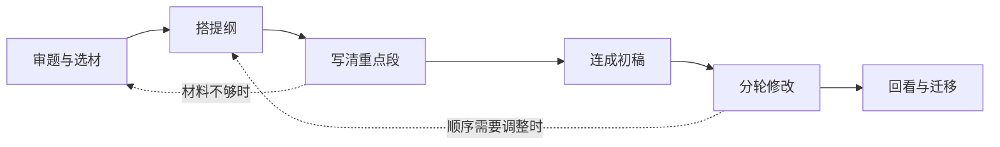

# 四年级作文专项练习设计

状态：设计已确认；第1题样板的实现范围见《chinese-writing-sample.md》，其余题材后续扩展。

设计依据：用户提供的《四年级作文提纲专项练习7篇》。文档提供七种题材，以选材、定主旨、排顺序、找重点、想结尾、整理提纲为主，并逐渐减少提示。本方案保留这些优点，再补上重点段、初稿和修改过程。文档中的题材、用时及参考安排作为设计参考，不直接成为强制规则。

## 1. 要教会什么

让学生逐步能回答六个问题：

1. 这次要写什么，题目有什么要求？
2. 我想让读者知道什么，哪些材料有用？
3. 先写什么，接着写什么，哪里值得展开？
4. 重点处有哪些动作、对话、观察或想法？
5. 各段怎样连成一篇说得清楚的文章？
6. 读者哪里可能看不懂，我怎样修改？

学习的成果包括选材记录、提纲、重点段、初稿、修改稿和一次简短回顾。文章长度作为写作提示；段数、修辞数量和字数增长不直接代表写得更好。

首批面向四年级，使用通用作文能力目标，不把这些题材标为某一版语文教材的完整作文范围。

## 2. 练习路径

| 步骤 | 学生做什么 | 页面上的启发 | 留下的成果 | 本步只看什么 |
| --- | --- | --- | --- | --- |
| 审题与选材 | 找题眼，确定对象，选一件事或一处地方 | “题目里哪个词提醒你要重点写？”“这件事为什么值得写？” | 写作对象、一句话想表达的意思、材料清单 | 材料与题目是否相合 |
| 搭提纲 | 排材料顺序，为每段安排任务，标出重点 | “这一段让读者知道什么？”“哪一段需要写得更具体？” | 可调整的段落卡片 | 顺序与详略是否清楚 |
| 写清重点段 | 先把最值得写的一刻或一处写具体 | “你写了‘很紧张’，开口前你做了什么？” | 一个重点段 | 有用的细节能否支持想表达的意思 |
| 连成初稿 | 补齐其他段，通读衔接 | “读到这里，读者知道为什么会这样了吗？” | 第一版完整文章 | 事情、观察或情节是否连贯 |
| 分轮修改 | 先看内容和结构，再看表达与字词 | “这段材料有用吗？”“哪句话可以让人看得更清楚？” | 一份修改稿和修改说明 | 一轮解决一两处问题 |
| 回看与迁移 | 对比一处修改，换题试用方法 | “你改了哪里？读者现在更容易明白什么？” | 版本对比、下一次练习目标 | 学生能否说清自己的修改理由 |

步骤可以回退。学生发现材料不够，可以回到选材；修改顺序后，原来的文字继续保留，系统提醒学生检查对应段落。

### 练习长度

提供三种选择，避免每次都要求完成整篇：

- **只搭提纲**：约 10-15 分钟，适合集中练选材、顺序和重点。
- **提纲＋重点段**：约 20-25 分钟，适合练“把关键处写具体”。
- **完成整篇并修改**：建议分两到三次，每次 10-20 分钟；安排随孩子实际情况调整。

首轮七题可先完成全部提纲，再挑两到三题继续写重点段或整篇。不同孩子可以在同一题停留不同时间。

## 3. 页面怎样组织

### 作文专项首页

语文站新增“作文专项”入口，作为独立的过程性练习模块。首页展示题材、今天练的能力、建议练习长度，以及“开始练习”“继续我的练习”。

进入首页时展示练习列表，不强制跳入上次未完成的编辑状态。同一道题可以新开一次练习，旧记录继续保留。

### 学生练习页

电脑端以当前任务为主，旁边放简短提示；手机端依次显示当前任务、输入区和按需展开的提示。一次呈现一组小问题，学生可以查看完整进度。

- 顶部：题目、今天练什么、步骤进度、保存状态。
- 主区：当前问题或段落卡片，输入关键词和短句即可起步。
- 提示区：按需点“给我一点提示”，默认不展开全部参考。
- 底部：上一步、保存并退出、完成本步／继续下一步。
- 完成页：我的提纲、初稿与修改稿，以及“我这次学会了什么”。

“完成本步”表示学生愿意进入下一步。系统可提醒明显缺项，但不能把“没有使用指定句式”“没有写够三段”当作错误。主观写作质量不设置机器硬门槛。

### 段落卡片

每张卡片保留稳定编号，包含：

| 项目 | 学生看到的说法 |
| --- | --- |
| 内容关键词 | 这一段准备写什么？ |
| 段落作用 | 写这一段，是想让读者知道什么？ |
| 详略 | 简要交代／重点展开 |
| 细节篮 | 可以用上的动作、对话、观察或想法 |

支持增加、删除、移动、合并卡片。初始卡片数量随题材变化，不固定成三段或四段。作用可以选择简短提示，也可以自己写。

从提纲进入正文后，卡片内容放在旁边供查看，正文由学生写。全文由各段组成，可点回对应段修改，避免“提纲一份、正文另一份”难以对应。

## 4. 七个题材与提示逐步减少

| 题材 | 主要练什么 | 提供的帮助 | 重点产出 |
| --- | --- | --- | --- |
| 一次有趣的课间游戏 | 把事情按顺序安排，把“有趣”落到具体一刻 | 给材料池和顺序线索，重点段提供动作／对话提示 | 提纲＋重点段 |
| 第一次自己买东西 | 写出变化，分清详略 | 给“开始怎样、后来怎样”的追问，段落由学生调整 | 提纲，选练完整文章 |
| 那一次，我没有放弃 | 删除无关材料，写清一次具体尝试 | 给可取舍材料，追问“换了什么办法” | 提纲＋一次尝试的展开 |
| 我的同学有个特点 | 用事情和言行表现一个特点 | 给特点与证据的对照提示，学生自选人物和事情 | 人物提纲＋证明特点的重点段 |
| 校园里的一个角落 | 按观察内容组织景物 | 提供观察顺序选择，提示真实看到的特点 | 观察提纲＋局部描写 |
| 从一个开头想出完整故事 | 让原因、线索和结果一致 | 只给开头与检查问题，学生补情节 | 情节提纲，选练完整故事 |
| 这件事，我记住了 | 自主选材、定重点、安排结尾 | 默认只显示任务与自查清单，提示仍可主动打开 | 独立提纲＋完整修改过程 |

提示减少要同时看学生是否已掌握、题材是否发生变化。第一次练写景时，仍需观察顺序的帮助，不能只按题号机械减提示。

给定材料练习、真实经历和想象故事应明确区分。没有类似经历时，可以使用练习情境；写真实经历时，不要求补上未发生或未观察到的细节。

## 5. 题材有各自的结构选择

| 题材 | 可供选择的组织方式 | 重点提示 |
| --- | --- | --- |
| 记事 | 事情发展；困难与尝试；心情变化与行动对应 | 把“怎样发生”和“怎样变化”接清楚 |
| 写人 | 一个特点与一件能证明的事 | 让读者从言行中看出特点 |
| 写景 | 整体到局部；空间位置；观察变化 | 顺序与实际观察相合 |
| 想象故事 | 问题、线索、尝试、解决 | 原因和结果接得上，前后信息一致 |

这些是可用的办法，不是唯一答案。参考提纲应说明为什么这样安排，也认可其他合理安排。

## 6. 启发式反馈

### 三层提示

1. **提醒方向**：例如“哪一刻最能看出这次游戏有趣？”
2. **提供观察维度**：例如“可以想一想动作、对话或当时的反应，选有用的一种。”
3. **给一个局部示例**：展示一个短句或不同情境的小例子，说明它的作用。

使用提示不扣分。学生先尝试后再看参考；确实卡住时也可以直接求助。完整范文不放在编辑区旁边作为默认内容。

### 每次反馈的格式

- 先指出孩子文本中一个具体、有效的地方。
- 引用一处需要继续想的文字。
- 只聚焦一个改进目标，提出一个能动手修改的问题。
- 学生自己选择是否采纳，并完成修改；允许保留原写法。

例如：“你把经过放在中间，顺序已经清楚了。这里写‘我做动作’，读者还看不到。猜错之前，你做了哪个动作？试着补一句。”

避免只给“内容不够生动”“多用好词好句”等笼统意见。修改充分时，可以选择“本轮不用改”，不要求为了留下修改痕迹而改字。

### 系统检查与主观反馈分开

首版系统可可靠检查是否有内容、是否标记重点、正文是否仍为空、修改稿是否已保存等事实。切题、真实感、细节是否有用等问题，通过自查、家长讨论及后续可选的教练反馈处理。

若后续接入 AI，限定为阅读孩子已有文字、引用依据、追问和提供局部帮助。每次最多提出一到两个问题；学生点击后才请求，不随每次输入调用。反馈失败时保留草稿，仍可继续学习。AI 不提供一键整篇代写或默认替换全文。

## 7. 修改顺序和评价

### 两轮修改

**第一轮看内容与结构**：材料是否合题，顺序是否清楚，重点有没有写出来，结尾能否接住前文。每次选一到两处修改。

**第二轮看表达**：句意是否清楚，重复是否有必要，词语是否准确，错别字和标点是否需要修正。第一轮尚未想清楚时，可以先不进入第二轮。

### 形成性评价

| 观察维度 | 给孩子的检查问题 |
| --- | --- |
| 题目与材料 | 我写的这件事、人物或地方，符合题目吗？ |
| 组织顺序 | 别人能跟着我的顺序读明白吗？ |
| 重点与细节 | 最值得写的地方，读者能看见具体发生了什么吗？ |
| 结尾照应 | 最后写的内容，接得上前面和题目吗？ |
| 表达清楚 | 有没有读起来不明白或反复说同一意思的句子？ |
| 修改意识 | 我能说清自己改了一处什么、为什么改吗？ |

各维度用“再想一想／已经做到／更清楚了”记录，并附文本依据。每步只显示相关的一两项，不默认折算百分制或排名，也不把使用提示当作扣分项。

## 8. 一题的完整教学示例

题目：一次有趣的课间游戏。以下为给定材料的练习示例，不要求孩子照搬成自己的真实经历。

**搭框架**

| 段落 | 我的关键词 | 让读者知道什么 | 详略 |
| --- | --- | --- | --- |
| 1 | 下课；我和同桌；猜词游戏 | 什么时候，谁在玩什么 | 略 |
| 2 ★ | 比画兔子；猜成青蛙；我们的反应 | 游戏最有趣的一刻 | 详 |
| 3 | 上课铃；回座位；还觉得好笑 | 游戏怎样结束，留下什么感受 | 略 |

**填入内容**

学生第一版重点段：“我做动作让他猜，他猜错了，我们觉得很好玩。”

教练先问：“猜错之前，你做了哪个动作？试着补一句。”学生补写动作，再根据需要想起一句对话或一种反应。系统不会同时要求每段都补动作、语言、心理和环境描写。

学生扩写后：“我把两根手指竖在头顶，跳了两下。同桌说：‘青蛙！’我们哈哈大笑，我觉得真好玩，真有趣。”

**最后优化**

本轮目标是减少重复评价，保留具体反应。提醒：“‘真好玩’和‘真有趣’表达接近。你准备保留哪一个，或者用当时的反应收住这一段？”

学生可以删去重复句，也可以自己补上一个符合材料的反应。系统展示改前与改后，再让学生用一句话说明：“我删掉重复评价，保留动作和对话，让有趣的地方更清楚。”

**迁移**

换成另一种游戏，只留“谁在玩—哪一刻最有趣—怎样结束”三个检查问题，观察学生能否自己安排重点。迁移题不继续沿用兔子与青蛙的参考情节。

## 9. 保存、角色与复盘

- 自动保存当前步骤、提纲和正文；明确显示保存状态，网络异常时保留本机草稿并允许重试。
- 保存提纲、初稿和修改稿的关键版本，允许比较、继续和另开一次练习。
- 学生主动点击“保存并退出”；下次在列表中选择继续，不强制打开旧编辑状态。
- 修改提纲或段落顺序后保留已写文字，提醒重新检查衔接，不自动重写正文。
- 同账号在不同设备或标签页产生冲突时，保留两份内容供处理，不静默覆盖。
- 家长可以查看关联学生的过程与版本，使用参考清单讨论；正文仍由学生编辑。首版不引入新的教师账号角色。
- 完成页展示一次有依据的进步，例如从笼统评价补出具体动作；字数和完成次数只作为过程信息。

## 10. 分期落地

### 首版：先验证学习闭环

先把第 1 题做成完整样板，包含审题、提纲卡片、重点段、初稿、两轮自查修改、版本对比与保存退出。验证孩子能否独立理解提示、找回草稿、说清一次修改，再配置其余六题。

七题共享编辑和保存能力，题材决定问题、结构建议与自查重点。首版采用精选的静态引导和自查，不依赖 AI 代写或自动打分。

### 后续增强

- 根据学生当前文本给出有引用依据的 AI 追问。
- 更多迁移题，以及不同年级的提示强度。
- 家长的过程反馈、打印／导出和更方便的输入方式。

### 接入现有站点的边界

- 复用现有统一账号和家长关联规则，只在语文站提供“作文专项”。
- 题目配置与学生作品分开；练习绑定题目版本，之后调整题目不会改写已有作品。
- 建议用独立写作存储保存练习、段落和版本；不套用英语题库的标准答案匹配或分数逻辑。
- “学习记录”聚合写作进度，但不把半成品当作考试成绩。
- 具备账号隔离、草稿恢复、并发保护后，再扩充内容或接入 AI。

## 11. 首版验收标准

1. 学生从一个题目出发，能留下属于自己的提纲、重点段和一次修改。
2. 不同题材能选择不同结构；段落可调整，参考安排不作为唯一答案。
3. 退出、刷新和重新登录后可以继续，进入首页时可自主选择继续或另开练习。
4. 提示不会直接覆盖学生内容；反馈能指向具体文本和一个改进动作。
5. 初稿与修改稿都可找回；家长只读、学生隔离、多标签页冲突得到保护。
6. 写作模块不会改动英语、数学的学习数据，也不依赖 AI 服务才能完成基础练习。
