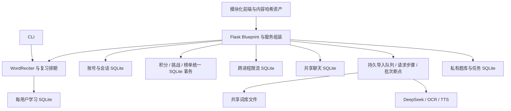

# 全代码审查与优化落地报告

日期：2026-10-29。基线提交：`2e75d12c00e142df9a8bd5235e00e0f52ef86f9d`。

## 结论与范围

本次按架构、性能、用户体验三个方向并行审查，再交叉复审、补充回归与浏览器验收。已修复影响数据保留、跨账号操作、后台任务归属、服务可用性和部署完整性的具体问题，并继续落地此前列为后续工作的事务账本、导入恢复、共享限流、模块拆分及性能优化。修复位于当前工作区，验证使用隔离数据；最终发布与验收状态由本文证据栏记录。

范围覆盖 Flask 路由与鉴权、CLI/学习排期、SQLite 与 JSON 存储、导入任务、词库与题目生成审核、聊天、OCR/TTS 接入、静态前端、维护脚本和部署配置。验证深度按风险分配；没有声称每个分支、第三方依赖或所有浏览器都已穷尽测试。

“99% 信心”作为迭代质量目标，不能转换为已经测得的 99% 线上可靠性。当前生产验收目标为 PM2/Linux 单机，最终全量回归、服务器实际安装依赖审计和业务验收仍按证据分别记录；Docker 或多主机部署不作为本次 PM2 上线完成的默认结论。

## 当前架构

鉴权、学习、词库导入和聊天处理器已经抽取为 `web_*_routes.py` 中的四个 Blueprint，通过显式 `services` 参数使用现有应用服务。入口负责组装、后台生命周期和其他接口；原有 API 与函数别名保留。前端源文件拆分到 `static/js/app/`，构建时生成兼容 bundle、内容哈希资产及 manifest。模块边界降低了维护成本，但共享服务仍集中在入口，不能据此声称已完成全部领域层重构。

积分、PK、月池及榜单结算现在共用 `rewards.sqlite3` 的事务，账户变动与业务标记一起提交；永久事件表不随界面历史裁剪而删除。导入使用持久请求步骤和候选批次 checkpoint 衔接外部响应、词库写入与题库候选恢复。限流统一到同一本地 SQLite，账户热路径按主键读取并仅写变化行。SQLite 与本地文件锁仍要求单机共享数据目录。

## 原始问题与已落地修复

优先级含义：P1 为可能造成数据丢失、跨账号操作或服务不可用的问题；P2 为明显的性能、协议或操作体验缺陷。以下状态均为已实现并有针对性验证。

| 优先级 | 原始触发条件与影响 | 落地修改 | 主要位置与证据 |
| --- | --- | --- | --- |
| P1 | 积分、挑战、榜单文件损坏时可能被空状态覆盖；跨文件账户与结算标记不能原子提交 | 迁移到统一 SQLite 事务账本，严格校验奖励结构，失败回滚；永久事件回执防止展示历史裁剪后重复奖励，接口安全返回 503 | `reward_store.py`、`reward_schema.py`、三个奖励模块；迁移、独立连接、崩溃与故障注入测试 |
| P1 | 旧题库损坏、无权限或类型错误可能被解释为新空题库；迁移竞争及跨查询读取可能产生不一致结果 | 保留有效 SQLite；坏源拒绝迁移，修复后可重试；锁内复查迁移标记；读数据与元信息使用同一快照 | `question_sqlite_store.py`、`learning_sqlite_store.py` 及对应测试 |
| P1 | 导入租约失效后旧执行者仍可能写入；崩溃恢复可能重发付费请求或遗漏候选批次 | 每 30 秒续租，执行代次校验；持久外部请求步骤复用已确认响应，候选批次 checkpoint 恢复本地写入；未知付费结果停止自动重试并转人工核对 | `import_job_store.py`、导入服务；租约、请求复用、候选恢复与未知结果回归 |
| P1 | 切换账号或退出后，旧请求、缓存及多批次操作仍可能影响当前界面或向新账号继续发请求 | 账号上下文与请求序号双重检查；清理私有 DOM、缓存、观察器和忙状态；批次前后确认原账号 | `static/js/app.js`、`textbook.js`、`chat-sidebar.js`；前端 VM 场景和真实浏览器切换账号 |
| P1 | 默认 4 个 Gunicorn 请求线程被常驻聊天 SSE 占满，正常请求无法及时处理 | 前端默认短轮询，隐藏标签暂停，错误退避；SSE 接口须显式启用 | `chat-sidebar.js`、`simple_web_app.py`；无默认 stream 请求的浏览器断言 |
| P1 | Docker 复制清单缺少实际导入的模块，词库更新也没有持久卷 | 补齐运行模块、bootstrap 依赖与前端构建步骤；词库挂载；构建上下文排除数据、密钥和缓存 | `Dockerfile`、`.dockerignore`、`docker-compose.yml`；传递导入闭包静态测试；不替代实际 Docker 构建验收 |
| P1 | 任意客户端伪造转发 IP 可绕过限流；不可信 Host 可进入密码重置链接；新家长账号共享默认密码 | 显式代理 CIDR 信任并从右向左解析；重置域名配置校验；独立随机初始密码，仅创建时返回 | `simple_web_app.py`、`.env.example`；`test_web_reliability.py` |
| P1 | 多 worker 的进程内限流各自计数，可放大同一来源额度 | 同机共享 SQLite 滑动窗口，在事务内检查与写入，保留过期清理和容量上限 | `rate_limit_store.py`；独立连接与共享额度回归 |
| P1 | 邮箱去重仅依靠应用全表扫描；迁移坏账号可能被跳过 | 规范化邮箱唯一索引、定向 owner 查询；并发冲突回滚；旧邮箱冲突或损坏 JSON 阻止初始化并保留源 | `user_store.py`、`test_user_store.py` |
| P2 | 聊天每次全量解析/排序 JSONL；大文件阈值使历史不可用；进程内通知无法覆盖其他 worker | 一次迁移至 SQLite，按自增序号索引分页，跨 worker 从同一数据库读取 | `chat_room.py`；分页等价性、超大历史、跨连接读取、资源关闭测试 |
| P2 | 分批列表与加载哨兵顺序错误，后续批次可能失效；注册变量遮蔽当前账号 | 稳定插入哨兵之前；释放旧观察器；提供手动加载回退；修正注册账号赋值 | `static/js/app.js`；150 个待学、130 个已掌握词完整加载 |
| P2 | 教材 VIP 导入收到 202 就提示完成，真实失败被掩盖；聊天发送推进游标可能跳过他人消息 | 教材等待后台任务真实终态；聊天统一通过增量拉取推进完整游标；历史按时间顺序前插 | `textbook.js`、`chat-sidebar.js`；异步和乱序响应测试 |
| P2 | SQLite 上下文只提交/回滚而未关闭，持续使用可能泄漏连接；限流桶无上限 | 明确连接生命周期；共享限流过期清理，最多 10000 个桶，不淘汰有效限额 | SQLite stores、聊天及限流；关闭路径与容量测试 |
| P2 | 单账户变更全量读取、重写用户表，开销随总账户数增长 | `mutate_users(..., usernames=...)` 按账户读取，所有模式只写变化行；事务防止并发覆盖 | `user_store.py`；SQL trace、并发更新和 1 万账户基准 |
| P2 | 300 词的全量 Python 编辑距离在长短语输入下可阻塞数十秒 | 预处理比较键、无损下界筛选、局部重复缓存及 RapidFuzz OSA；保留等价 Python 降级 | `reciter.py`、`test_spelling_similarity.py`；穷举与三组逐项排序基准 |
| P2 | Flask 入口和前端巨型脚本增加维护成本；immutable 资源需要人工改查询版本 | 四个 Blueprint 与前端源模块；自动生成内容哈希文件和 manifest，部署集成构建 | `web_*_routes.py`、`static/js/app/`、`scripts/build_assets.py` |
| P2 | `gzip;q=0` 被错误压缩，普通响应缺少协商缓存标志 | 尊重压缩权重，统一设置 `Vary: Accept-Encoding` | `simple_web_app.py`；协议断言 |
| P1 | 固定依赖及允许下限命中已公开安全公告，旧 bootstrap 工具也需审核 | 按 PyPI/OSV 证据升级应用依赖，固定已审核的 pip/setuptools；完整 installed 环境另做服务器审计 | `requirements-simple.txt`、`requirements-bootstrap.txt`；直接依赖和 bootstrap 审计 JSON |
| P2 | 两个词库维护脚本在 Windows 下遇到默认编码和 POSIX 专属 API 失败 | 显式 UTF-8，平台适配元信息与目录同步，失败时保留源文件并清理临时文件 | `scripts/repair_wordbank_*.py`、`storage_utils.py` 及脚本测试 |

前端账号保护也覆盖头像异步编码、OCR 旧任务完成、发现页旧 401、设置/邮箱、排行榜切换、XP、教材预取/词条查询、系统词库导入和批量删除。已经发出的请求仍由服务端依据请求原有令牌执行，前端负责阻止切换后继续发出后续批次和展示过期结果。

## 性能证据

聊天基准比较基线提交的 JSONL 实现与当前 SQLite 实现，使用相同合成记录。每种数据量和分页模式先预热 2 次，再交替测量各 11 次；每次检查分页返回内容一致。环境为 Windows 10、Python 3.14.3、SQLite 3.50.4，以下均为本地函数调用中位数。

| 消息数 | 分页模式，每页 50 条 | 原实现 ms | 当前 ms | 比值 |
| ---: | --- | ---: | ---: | ---: |
| 10000 | 最新页 | 155.56 | 4.63 | 33.59 倍 |
| 10000 | 指定位置之后 | 132.59 | 4.54 | 29.24 倍 |
| 10000 | 指定位置之前 | 131.90 | 4.87 | 27.08 倍 |
| 50000 | 最新页 | 677.98 | 4.73 | 143.43 倍 |
| 50000 | 指定位置之后 | 648.58 | 4.38 | 147.96 倍 |
| 50000 | 指定位置之前 | 620.37 | 4.03 | 154.03 倍 |

一次性迁移约为 3.46 秒和 8.54 秒，未计入分页时间。存在尾部慢样本；这不是 HTTP p95、并发压测或生产 SLA。SQLite 增加了索引与数据库空间；首次迁移需要维护窗口。基准脚本与原始样本保存在本机忽略目录 `.nox/review-runtime/chat_benchmark.py`、`.nox/review-runtime/chat-benchmark-f3d91b863e/results.json`。

短轮询减少默认长连接线程占用，但仍会产生周期请求。展开间隔 3 秒、收起 20 秒，隐藏时暂停；活跃用户增加后应测量代理 QPS 和请求延迟，再决定独立实时服务或合适的异步 worker。

新增用户存储和排序基准在 Python 3.12.14 下执行，原始样本、脚本与方法见 [性能及依赖专项报告](performance-security-review-2026-10-29.md)。单账户事务使用 7 轮交替测量，300 词排序使用 3 轮交替测量；最终状态或输出顺序逐项一致。

| 场景 | 原实现中位数 ms | 当前中位数 ms |
| --- | ---: | ---: |
| 100 账户中修改 1 个账户 | 2.218 | 0.192 |
| 10000 账户中修改 1 个账户 | 257.870 | 0.219 |
| 300 条随机无关字符串排序 | 5661.50 | 327.02 |
| 300 条词族字符串排序 | 2922.35 | 371.36 |
| 300 条长短语排序（100 条唯一内容各重复 3 次） | 61576.40 | 194.78 |

这些是本地合成数据的函数耗时，长短语组明显受益于重复比较缓存；不能直接当作真实用户词汇分布、HTTP p95 或生产容量。缺少 RapidFuzz 时虽然有等价降级路径，但不能获得表中性能，部署必须安装声明依赖。

## 迭代与验收

1. 第一轮：三个方向并行梳理主路径与问题，优先修复数据完整性、部署、聊天性能和列表体验。
2. 第二轮：交叉复审并加入并发迁移、执行代次、读取失败、账号切换及乱序回包回归，修复发现的跨模块遗漏。
3. 第三轮：运行全量回归并处理 Windows 维护脚本兼容性；补充真实浏览器场景和新旧实现性能对比。
4. 第四轮：复查账号边界、旧题库错误传播、缓存发布版本和部署升级要求，再执行最终全量回归。
5. 延伸迭代：继续完成统一奖励事务、导入持久步骤/批次断点、跨进程限流、Blueprint 与前端模块拆分、哈希资产、用户增量 SQL、排序加速和依赖修复，再执行跨模块复审与最终验收。

前一阶段全量回归曾通过 **788 项测试及 12 项子测试**，耗时 423.78 秒，记录为 `.nox/review-runtime/pytest-verified.xml`；该结果早于延伸迭代，不能作为当前代码的最终全量结果。前端 VM 场景由 Python 测试入口触发，不应叠加为独立 pytest 测试数。

当前最终代码在服务器 Linux/Python 3.11.6、pytest 9.2.0 与升级后的完整依赖环境下运行：**871 项测试、12 项子测试通过，0 失败，耗时 24.30 秒**。资产构建校验与 `pip check` 通过。JUnit 留档 `.nox/review-runtime/pytest-linux.xml`；服务器路径为发布目录下 `.verification/pytest-linux.xml`。奖励专项另覆盖真实进程退出、跨用户回滚和多进程事件重放，最后一轮 79 项通过。

Linux 独立 localhost:8012 Gunicorn 使用 2 worker、每 worker 4 threads。真实注册、邀请码复用拒绝、登录、会话跨 worker、错误密码/令牌拒绝、7 份哈希资产、共享限流与注销均通过。三轮各 500 次混合请求、并发 8，共 1500 次请求零错误，p50 分别 10.42/10.05/11.22 ms，p95 为 26.56/31.59/34.99 ms。限流同一测试来源共允许 20 次并拒绝其余 12 次；普通来源仍可登录。注销后的 24 次请求在两个 worker 均返回 401。验收进程组已清理。首轮曾遇一次连接重置，增加分步与日志诊断后未复现；连续执行时的 TIME_WAIT 误报已修复，未对业务请求增加重试。短时轻负载不等于长期生产容量。

生产数据逐库在线副本迁移预演通过：28 个用户、8 个邮箱绑定，31 份奖励文档、6906 条事件；17 份旧奖励文件保留、数值不变、第二次读取幂等。该副本仅逐库一致，正式发布另需停服备份和精确副本恢复演练。

正式部署已完成：[https://english.itorange.online](https://english.itorange.online)。保留 1 worker、4 threads，监听 `127.0.0.1:8000`，仅信任 loopback 反向代理，PM2 状态已保存。服务器原有其他站点未改动。

停服后备份至 `/data/english_reciter-backups/review-20261029-99b7a1`，保存旧代码、旧虚拟环境、运行数据、词库与私密配置。恢复到独立目录后，1229 个文件逐项哈希匹配，53 个 SQLite 数据库完整性检查通过，精确副本的 28 个账户迁移通过。新版本在私有 8013 端口完成迁移和资产验收，确认进程组退出后才正式启动 8000；禁止新旧 worker 混跑。

备份清理记录：2026-10-29 13:22（Asia/Shanghai）按用户要求，在复验线上健康、7 份资产、鉴权、22 个活跃 SQLite、28 账户与依赖均正常后，删除上述部署备份、生产数据副本、恢复演练副本及发布目录中的验收配置副本，共约 1.76 GB 文件数据。当前新 `.venv`、生产数据及发布证据保留，删除后公网复查通过。本次旧版本备份已不可用于回滚，状态见验收 JSON 的 `backup_status` 与 `backup_cleanup`。

发布时备份用的安全 umask 误用于新静态目录，导致 Nginx 返回 404；已将公开目录改为 0755，并修复发布脚本的权限边界。进一步修复构建器临时文件默认 0600 的潜在问题，新建目录 0755、发布文件 0644，并新增 Linux 严格 umask 回归；最后再次完成 871 项全量测试。构建器补丁归档和文件哈希记录于验收 JSON 的 `post_release_patch`。期间保留新版本运行数据，没有回滚用户写入。最终公网健康、全部 7 份资产的内容哈希和缓存、认证拒绝均通过。28 个账户与备份一致，602 个词库文件逐项保持一致，配置与原有密钥保持不变，奖励账本包含 31 份文档和 6906 条事件。具体结果见 [部署验收记录](deployment-verification-2026-10-29.json)。

正式域名的 Edge/Playwright 在 1280x900、390x844、320x760 三个视口均无缺失资产、横向溢出或 pageerror，截图保存在 `.nox/review-runtime/production-*.png`。

服务器最终 `pip-audit` 检查安装环境的 96 个可审计包，**未发现已知漏洞**。首次审计发现旧 pip/setuptools 的公告，升级到 26.2.2/84.1.0 后复审通过。另有 1 个本地 spaCy 模型 `en-core-web-sm 3.8.0` 不在 PyPI，公告查询跳过，不能视为已审计。完整输出见 [installed 依赖审计](installed-dependency-audit-2026-10-29.json)。这不证明不存在未公开漏洞。

真实 RapidOCR 识别出 apple/benefit；Piper 生成 22050 Hz 单声道、18490 帧、0.839 秒 WAV；spaCy 正确得到 apple/benefit 词元。DeepSeek `GET /models` 返回 200，SMTP 使用 TLS 1.3 登录成功；没有付费生成或发送邮件，因此没有将账单、邮件送达或听感列为已验证。

前一阶段两次全量运行暴露了 Windows 脚本兼容性、图片依赖缺失和托管运行时注入 CA 后的测试前提错误，均在该阶段验收前处理。TLS 测试改为可控模拟空证书统计并验证真实证书加载，没有关闭证书验证。

前一阶段前端专项由 Python 测试入口执行 Node VM 场景：应用/教材 35 个，聊天 6 个，均通过。VM 测试用于可控地制造慢响应、乱序、账号切换及旧回调，不能替代真实浏览器的布局和输入检查。

前一阶段真实 Edge/Playwright 使用隔离演示数据验证了以下流程；源模块与资产构建完成后的最终浏览器验收需单独补记：

- 视口 `1280x900`、`390x844`、`320x760`，页面无横向溢出和 JavaScript 页面异常。
- 登录、150 个待学词与 130 个已掌握词完整加载、聊天发送接收、退出、换号后只显示另一账号的 2 个待学/1 个已掌握词。
- 无默认 SSE 请求；聊天桌面与窄屏截图已人工查看。
- Enter 开始学习、等待输入焦点、输入答案并 Enter 提交，服务端确认正确和已记录；刷新后复习次数及拼写尝试保留。

浏览器与键盘脚本、截图保存在 `.nox/review-runtime/`，没有访问真实账号或调用外部付费服务。

最终前端源模块与 hash bundle 的 Edge/Playwright 隔离业务验收仍覆盖上述三个视口、150/130 条完整列表、聊天、换号 2/1 条数据隔离与键盘答题后刷新保留，均无横向溢出和 pageerror。Node VM 应用场景更新为 39 个，聊天 6 个，均通过；这些场景不重复叠加至 pytest 数量。

## 升级与回滚

详见 [部署文档的升级说明](../DEPLOYMENT.md#2026-10-29-可靠性升级)。当前目标是 PM2/Linux：完整停止全部旧 worker、后台任务与维护脚本，备份同一时点的代码、依赖、配置、用户数据和词库，再统一启动新版本。禁止 `pm2 reload`、滚动更新或新旧 worker 混跑。

奖励、学习与聊天旧 JSON/JSONL 迁移后保留但不再同步，账号 JSON 成功导入后重命名备份；这些源文件不能作为当前状态备份。题库仍按旧 JSON 的修改时间和大小检测变更并全量重导，单独覆盖旧 JSON 可能覆盖 SQLite 增量。回滚必须恢复同一时点的整套代码与数据，不能只回滚代码、JSON 或单个 SQLite 文件。

多 worker 依赖同一本地数据目录、可靠的 SQLite WAL 与文件锁；此方案未验证网络共享盘或多主机多副本写入。

`PUBLIC_BASE_URL`、`TRUSTED_PROXY_IPS` 和旧家长账号密码需人工核对，已有家长密码没有自动重置。邮箱按去首尾空格及 `casefold()` 建立唯一键，旧冲突或损坏账号 JSON 会阻止初始化并保留数据。奖励等损坏状态会拒绝覆盖，应保留现场后修复或从一致备份恢复。

永久事件表保护迁移时可见及升级后产生的事件，不会重建升级前已经裁剪的 ID，也不会自动纠正已发生的重复奖励、漏记和历史余额差异。导入对已确认请求/批次进行恢复；付费外部请求结果未知时停止自动重试，需先人工核查供应商请求、账单和本地数据，再决定补偿或新建任务，不能删除步骤记录绕过保护。

## 持续维护边界

上一版列出的统一奖励事务、导入副作用保护、共享限流、模块拆分、用户定向 SQL、排序测量/加速、哈希资产及依赖审核已落地。PM2/Linux、原生模型、真实双 worker、生产副本迁移、停服备份恢复和公网验收也已完成。以下为持续维护或不同部署目标的边界，不影响本次单机上线状态：

| 顺序 | 工作与理由 | 验收标准 |
| --- | --- | --- |
| 1 | 长期容量观测 | 已完成短时轻负载；真实长期用户量变化时继续记录 CPU、内存、延迟和锁等待，不能将本次 localhost 结果视为公网 SLA |
| 2 | 未知外部请求处置 | 保护和故障回归已实现；实际发生未知付费结果时先核账，不自动重发或宣称恰好一次扣费 |
| 3 | 邮件送达、AI 内容和音频听感 | 本次验证真实模型、只读 AI 鉴权和 SMTP 登录；不发送邮件、不做付费生成，没有声称这些结果和听感已验收 |
| 4 | 常规维护 | 继续按业务需要收敛共享服务、补充非奖励 JSON 的 schema，并追踪新依赖公告，不为文件体积引入新组件 |
| 5 | Docker 或多主机 | 本次服务器使用 PM2；这类新目标需独立构建/持久卷验收，多主机必须先设计存储和锁语义 |

不建议仅为模块大小立即引入分布式队列、Redis 或改用另一数据库。以本轮已完成的事务、恢复和幂等约束为基础，继续测量实际容量，再依据负载与部署需求选择组件。

## 信心边界

已知缺陷已有实现及针对性回归，用户事务与排序有可复现性能样本，Linux 全量回归、96 个可审计安装包、原生模型、备份恢复和正式域名验收均有证据。奖励结构已增加嵌套校验，剩余非奖励 JSON 并非全部具有完整 schema；本地 spaCy 模型的漏洞公告查询被工具跳过。

已验证多 worker 轻负载和整套备份恢复；没有实施真实断电破坏测试、长期容量测试、付费 AI 生成、邮件发送、TTS 听感或所有浏览器穷举。本文以修复、回归和明确的部署约束说明信心来源，不将未测场景折算为一个系统可靠性百分比。
